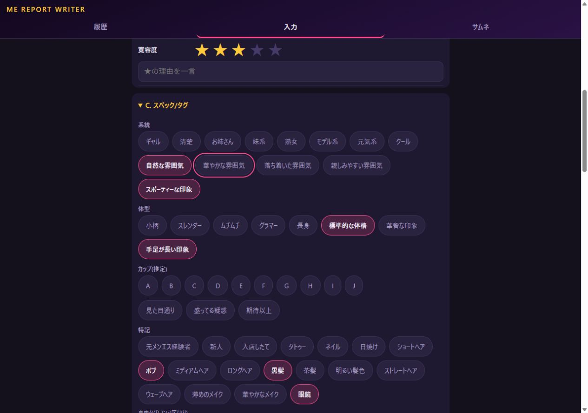

# Cの語彙拡充と組み込み記録

作成日：2026年10月23日

基準：`e33c331`（`main`）に今回の追加を適用。

状態：20語を既存のC項目へ追加し、実装と検証を完了。

## 追加した内容

Cの系統、体型、特記へ20語を追加した。従来の系統8語、体型5語、特記6語を維持し、現在は系統13語、体型8語、特記18語となった。カップと実感の単一選択、自由タグの手入力も維持している。

B・D向け87語の表示や操作、実装済みのDの選択順は変更していない。新しい質問や保存フィールドは設けず、以前に却下した10群・33小問も却下済みのままである。

全20語の保存先、値、根拠と利用条件は[追加語一覧CSV](research/men-esthe-2026-10-23/planning/c-vocabulary-candidates.csv)、従来の語や除外語との対応は[追加語データJSON](research/men-esthe-2026-10-23/planning/c-vocabulary-candidates.json)に記録した。検証結果は[実装確認記録](research/men-esthe-2026-10-23/planning/c-vocabulary-validation.json)を参照する。

| 追加先 | 語数 | 追加した語 |
|---|---:|---|
| 系統 | 5 | 自然な雰囲気、華やかな雰囲気、落ち着いた雰囲気、親しみやすい雰囲気、スポーティーな印象 |
| 体型 | 3 | 標準的な体格、華奢な印象、手足が長い印象 |
| 特記：髪の長さ | 4 | ショートヘア、ボブ、ミディアムヘア、ロングヘア |
| 特記：髪色 | 3 | 黒髪、茶髪、明るい髪色 |
| 特記：髪の形 | 2 | ストレートヘア、ウェーブヘア |
| 特記：メイクや身につけたもの | 3 | 薄めのメイク、華やかなメイク、眼鏡 |

## 根拠と意味の範囲

系統5語は原332候補の `appearance_02`〜`appearance_06` に対応する。元記事との意味照合記録があり、参照IDも追加語データへコピーしている。今回、Cへの配置を新たに記事本文から検証したわけではない。

体型3語と特記12語は、今回の設計上の提案を採用したもの。原332候補の個別照合済み語として追加したものではない。原資料の照合済み184語、未照合148語という状態は変更していない。

落ち着いた雰囲気と親しみやすい雰囲気は、接客や会話の感想としても使われる。外見から受けた印象をCに、応対への評価をBに記録する。Cで選んだ語からBの評価理由や星を自動で作ることはない。

髪型や髪色の写真との差を記した精読メモはあるが、そこから具体的な長さや色は確定できない。写真から髪型が変わっていたという記録を、ボブの直接根拠にはしない。関連するメモとその限界も追加語データに分けて残した。

新しい語は今回本人が見た内容や受け止め方の記録に使う。未選択から反対の属性を補わない。年齢、身長や体重の数値、経歴、性格などを語彙から生成することもない。新しい確定プロフィール語は今回の資料から抽出していない。

## 既存語との整理

細身の意味だけなら既存のスレンダー、高身長なら長身、小さい体格なら小柄を使う。同じ意味の別ボタンは増やしていない。華奢な印象は、体格や骨格への受け止め方を別に残したい場合の語である。

自然な雰囲気を清楚、華やかな雰囲気をギャル、スポーティーを元気系、落ち着いた雰囲気をクールへ自動変換しない。意味が重なっても、その語だけで同じ分類には決められない。

写真との印象差、会話量、清潔さや香りの評価、施術の強さ、再訪理由はBやDの既存欄で扱う。

## 保存先と記事素材への出力

系統、体型、特記の既存フィールドへ候補値を追加した。[types.ts](../src/types.ts)の型と表示語、[スキーマ](../schema/visit-record.schema.json)のenumを同時に増やした。既存の値と表示語、保存キーを維持し、既存記録の一括変換は行っていない。

フォームは表示語の定義からチップを作るため、画面構造や見出しを変えず、各欄の末尾へ追加語を表示する。各欄の複数選択、編集時の復元、スペック出力を既存の経路で扱う。Cの語を押した順から出来事の経過を作る機能は設けていない。

追加語データの `proposed_value` と `proposed_label` は整理時の名前を残したもので、同じ値と表示語を実装した。実装値は `implemented_value` と `implemented_label` にも記録している。

出力経路は次のとおりで、今回変更していない。

| 保存先 | 本文用スペック `specSummary` | タグ候補 `tagCandidates` |
|---|---|---|
| `spec.genre` | 渡る | 渡る |
| `spec.body` | 渡る | 現在は渡らない |
| `spec.notes` | 渡る | 渡る |
| `spec.freeTags` | 現在は渡らない | 渡る |

自由タグを候補ボタンへ変える案は今回採用していない。自由タグは引き続き任意の手入力で、タグ候補へ渡る。本文用スペックへ自由タグを加える変更も行っていない。

## 検証

[回帰テスト](../src/spec-vocabulary.test.ts)に3件を追加した。全20語の表示、複数選択から入力収集、検証付き保存、JSON書出しと読込、編集再描画までを確認する。本文用スペックとタグ候補の経路についても、体型や自由タグを意図せず混ぜていないことを確認した。

`npm test` は11ファイル・153件が成功し、`npm run build` も成功した。コードレビューとTypeScriptレビューで指摘事項はなかった。

実画面ではCの三つの欄で複数語を選択して保存し、ページ再読み込み後に編集して同じ選択が復元されることを確認した。星は変化していない。1280px、390px、320px幅で横にはみ出さず、狭い画面でもチップの高さは44px以上だった。

候補の整理、実装、レビュー、検証はGPT内で完結した。GrokやGeminiへの委任は行っていない。
